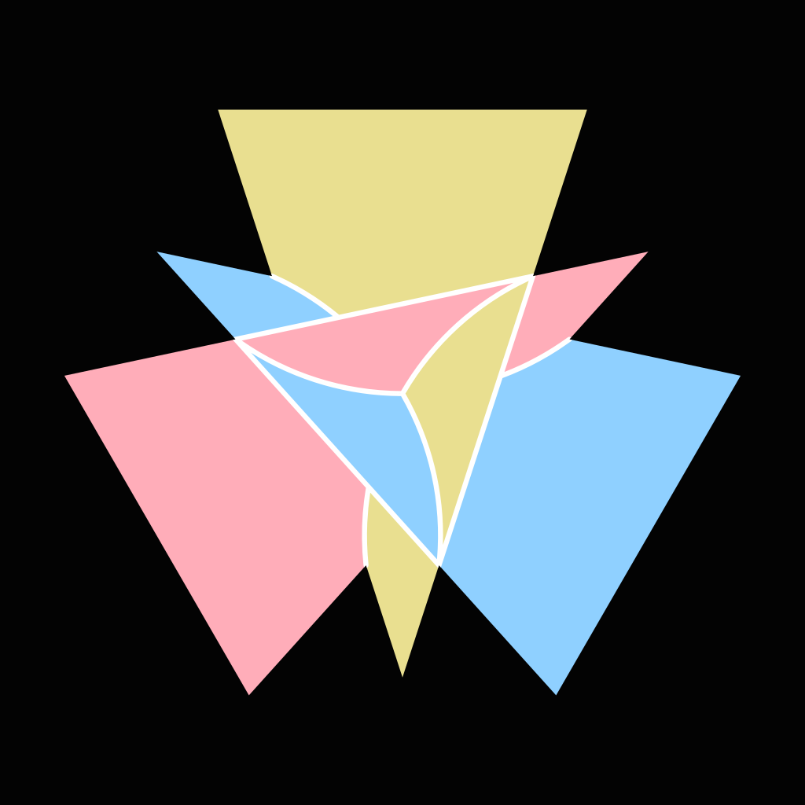
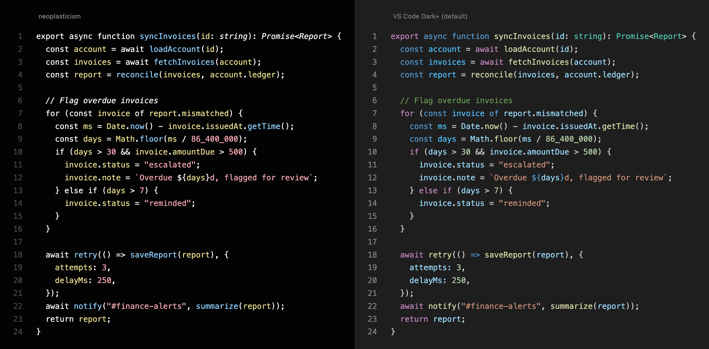

<p align="center">
  
</p>

<h1 align="center">neoplasticism</h1>

<p align="center">A color theme with three colors, after Mondrian.</p>



Inspired by Logan Smith's [How to write the perfect function](https://www.youtube.com/watch?v=2OMRWPOSw9s), which points to Tony Van Eerd's [Value Oriented Programming](https://www.youtube.com/watch?v=b4p_tcLYDV0), which points to Sean Parent's [A Possible Future of Software Development](https://www.youtube.com/watch?v=4moyKUHApq4). Consider this the next link in the chain: watch them in order once you're done here.

## Why

When I'm skimming code, whether something is a `const` or a `let` is an implementation detail. What I care about is whether it's a value or a function. So why give `const` a color?

Most themes do anyway. They color your code the way a parser sees it: keywords one color, types another, strings and numbers another. `await`, `for`, and `export` all match because they're keywords, though one waits, one loops, and one shares code with other files. That's the language's view of itself, useful if you're building one. Most of us are writing logic in it, and for that it's color for the sake of color.

So neoplasticism is minimal on purpose. It uses three colors, all equally soft (the same OKLCH chroma, with yellow a touch lighter), so there's less to decode and no single word grabs your eye. What stands out is the shape the colors make together. And instead of the parser's categories, it sorts code into the three kinds of thing you actually reason about:

- **Red: literals.** Strings, numbers, booleans: the values written straight into the code.
- **Yellow: names.** Variables, parameters, properties, constants. Anything that holds a value gets one color.
- **Blue: functions.** Where data comes from and where it goes. Calls into other code stand out.

Everything else stays white: keywords, types, operators, punctuation. Types and comments are italic, which sets them apart from the rest of the white. Types are still there when you want to dig in, but they shouldn't be what you need to follow the code. They're for the compiler.

I built it with agent-written code in mind. Agents rarely trip on syntax; where they slip is an old rule: keep each function at one level of abstraction. A good function reads like a list of steps, with the details tucked into the functions it calls. Agent code often mixes the two, and the details pull you away from what the function is doing. The colors make that quick to spot-check:

- **Yellow and blue, no red** is a list of steps: data handed from one call to the next, like lines 2–4 above.
- **Red showing up** is detail: numbers and strings written inline, like the loop on lines 7–16.
- **Both in one function** means it's mixing levels. That loop belongs in its own function.

The name is Mondrian's word for his style: only the three primaries, held together by black lines on white. Here the canvas is flipped. The background is black and white is the structure.

## Install

### Everything at once

```sh
git clone https://github.com/brysontang/neoplasticism
cd neoplasticism && ./install.sh
```

Builds every theme and links each one where its app looks, skipping apps you don't have. Safe to re-run. Keep the clone around: themes are symlinks into it, so `git pull && ./install.sh` updates them. Apps that are already running need a reload, and the script prints how for each one. When it has to edit one of your configs (adding an include, commenting out a competing color), it marks the line with `# [neoplasticism]` and backs up the original to `~/.local/state/neoplasticism/backups/`.

### One app at a time

| App | Install |
|---|---|
| Neovim | With lazy.nvim: `{ "brysontang/neoplasticism", lazy = false, priority = 1000 }`, then `vim.cmd.colorscheme("neoplasticism")` |
| VS Code | Download the `.vsix` from [Releases](https://github.com/brysontang/neoplasticism/releases/latest), then Extensions → ⋯ → Install from VSIX, and pick it in Preferences: Color Theme |
| Ghostty | Save [`dist/ghostty/neoplasticism`](dist/ghostty/neoplasticism) to `~/.config/ghostty/themes/`, then set `theme = neoplasticism` |
| tmux | Save [`dist/tmux/neoplasticism.conf`](dist/tmux/neoplasticism.conf) and `source-file` it at the end of `tmux.conf`. Needs truecolor: `set -as terminal-features ",xterm*:RGB"` |
| git | Save [`dist/git/neoplasticism.gitconfig`](dist/git/neoplasticism.gitconfig), then `git config --global --add include.path <where you saved it>` |
| Blink (iPad) | Settings → Appearance → Themes → Add, with `https://raw.githubusercontent.com/brysontang/neoplasticism/main/dist/blink/neoplasticism.js` |
| Anything else | [`dist/base16/neoplasticism.yaml`](dist/base16/neoplasticism.yaml) works with any [tinted-theming](https://github.com/tinted-theming) builder. base16 gives each color its own meaning (variables are red there), so use it for terminals and UI tools, not editors. |

## Make it yours

`palette.toml` is the only place a color is written down. `build.py` renders every file in `templates/` from it into `dist/` (and `colors/` for Neovim), and an unknown color name fails the build with the file and line. Edit the templates, not the generated files.

- **Change a color:** edit `[colors]`, run `./install.sh`.
- **Change what a color means:** edit `[roles]`, e.g. `variable = "blue"`.
- **Add an app:** drop a file in `templates/<app>/` with colors written as `{{ name }}` (`{{ variable }}`, `{{ gray2 }}`, `{{ ansi.bright_red }}`, `{{ accent | rgb }}`), then add a few lines to `install.sh` to link it.

Needs Python 3.11+ or [uv](https://docs.astral.sh/uv/). Nothing else.

## Status

Early. I'm sharing it now to document the idea as I use it day to day, so expect the rules to move. Issues and opinions welcome. Code is meant to be argued about.

## License

[MIT](LICENSE)
